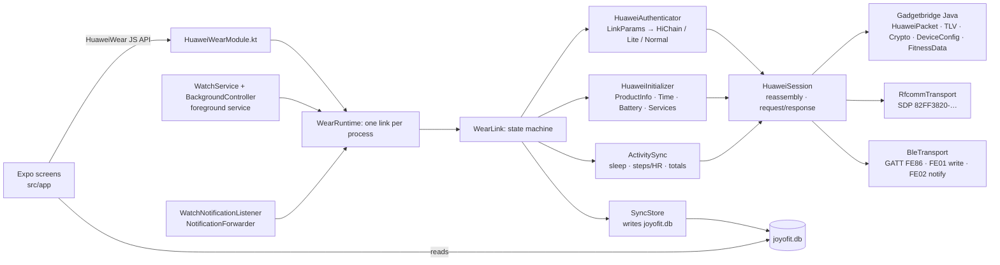
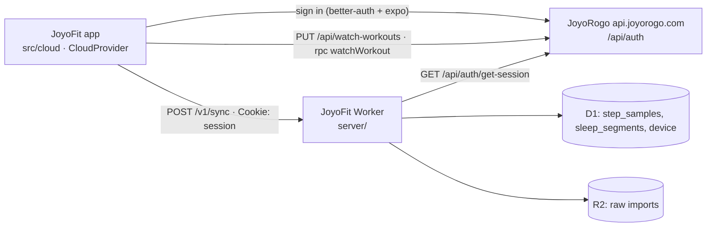

# JoyoFit

Website: <https://fit.joyorogo.com> (source in [`site/`](site/)).

JoyoFit is an Android companion app for Huawei and Honor watches. It was built for, and is tested only on, the **Huawei Watch Fit 4 Pro**; other models are experimental (see [Supported watches](#supported-watches)). It has no Huawei
Health install and no account needed: data goes from the watch to the phone into a local SQLite
database. Optionally, signing in with a JoyoRogo account syncs it with your own Cloudflare backend and JoyoRogo
(see [Cloud sync](#cloud-sync)); nothing leaves the phone before you do.

The app has two parts:

- an Expo (SDK 57) React Native app for the screens;
- `modules/huawei-wear`, a local Expo module that implements the watch's protocol. It is a port of
  [Gadgetbridge](https://codeberg.org/Freeyourgadget/Gadgetbridge)'s Huawei support.

## Supported watches

JoyoFit talks to Huawei Watch models over Bluetooth Classic (RFCOMM), the link the Watch Fit 4 Pro uses, and to Huawei and Honor bands over Bluetooth LE (GATT). The model list comes from Gadgetbridge's Huawei support (see `WatchModels.kt`). **Only the Huawei Watch Fit 4 Pro has been tested with JoyoFit.** Everything else is a best guess until someone tries it.

| Status | Watches | Notes |
| --- | --- | --- |
| **Tested** | Huawei Watch Fit 4 Pro | Checked on a real watch. |
| **Experimental** | Huawei Watch Fit 4, Huawei Watch Fit 5, Huawei Watch Fit 5 Pro, Huawei Watch Fit 3, Huawei Watch Fit 2, Huawei Watch GT 2, Huawei Watch GT 2 Pro, Huawei Watch GT 3, Huawei Watch GT 3 Pro, Huawei Watch GT 3 SE, Huawei Watch GT 4, Huawei Watch GT 5, Huawei Watch GT 5 Pro, Huawei Watch GT 6, Huawei Watch GT 6 Pro, Huawei Watch GT 7, Huawei Watch GT 7 Pro, Huawei Watch GT Runner, Huawei Watch GT Runner 2, Huawei Watch GT Cyber, Huawei Watch 3, Huawei Watch 3 Pro, Huawei Watch 4, Huawei Watch 4 Pro, Huawei Watch 5, Huawei Watch D2, Huawei Watch Ultimate, Huawei Watch Ultimate 2, Huawei TalkBand B6, Honor MagicWatch 2, Honor Watch GS 3, Honor Watch GS Pro, Honor Watch 4, Honor Watch 4 Pro | Bluetooth Classic models in Gadgetbridge's list. Never tried with JoyoFit, so some or all features may not work. |
| **Experimental** | Huawei Watch Fit, Huawei Watch GT, Huawei Watch GT 2e, Huawei Band 2, Huawei Band 2 Pro, Huawei Band 3, Huawei Band 3 Pro, Huawei Band 3e, Huawei Band 4, Huawei Band 4 Pro, Huawei Band 4e, Huawei Band 6, Huawei Band 7, Huawei Band 8, Huawei Band 9, Huawei Band 10, Huawei Band 11, Huawei Band 11 Pro, Honor Band 3, Honor Band 4, Honor Band 5, Honor Band 6, Honor Band 7, Honor Band 9, Honor Band 10, Honor Watch | Bluetooth LE (GATT) models in Gadgetbridge's list. **Untested, please report:** the LE link was ported from Gadgetbridge without a band to try it on, so connecting, pairing or sync may fail. Connect once and send the report (see below). JoyoFit lists bonded devices, so the band must show up as paired in Android's Bluetooth settings. Band 3e and 4e use a variant of the handshake. Honor Band 7, 9 and 10 use Honor's own GATT service, and Gadgetbridge calls those three experimental too. |
| **Not yet** | Honor Watch 5, Honor Watch 5 Pro, Honor Watch 6 | Honor's newer pairing (HiChain PAKE) is not implemented. |
| **Not yet** | Earphones (FreeBuds, FreeClip, FreeArc, FreeLace, Earbuds) | Not watches; they do not speak the watch protocol. |

A Huawei or Honor watch that is not in the list is **unknown**: JoyoFit tries to connect to it like a Huawei watch (over Bluetooth Classic, or over Bluetooth LE if Android reports the device as LE only), and it may not work. Anything that is not a Huawei or Honor watch is refused.

### Help support your watch

If you own an experimental or unknown model, connecting once helps a lot:

1. Pair the watch and connect it in JoyoFit.
2. Open the **Watch** tab, then **Help support your watch**, then **Report on GitHub**.
3. The app opens a prefilled [watch report issue](https://github.com/dzulfikar08/joyofit/issues/new?template=watch-report.yml) and copies the full report to the clipboard. Say what works and what does not, paste the report into the **Log** field, and submit. **Share as text** sends the same report anywhere else.

The report is plain text: app version, phone, watch model and software, supported commands, ExpandCapability and the connect log. It has no Bluetooth addresses and no serial number.

No watch to test with, or your model is not listed? The [Dukung jam](https://fit.joyorogo.com/dukung-jam) page (Indonesian) explains how to lend a device for testing, pool funds, or request a model.

## How it talks to the watch

The Fit 4 Pro (and the other Classic watches) use **Bluetooth Classic RFCOMM** by default. Huawei and Honor bands speak the same packet
protocol over **Bluetooth LE GATT** (service `0xFE86`, write `FE01`, notifications `FE02`; Honor Band 7, 9 and 10 use Honor's own
service), which `BleTransport` carries. The Fit 4 Pro also exposes that service over LE: with the developer switch below, link params,
HiChain3 auth, battery and an activity sync all ran over GATT on a real watch (see `protocol/README.md`, Observations). `WatchModels.kt`
picks the transport per model. See [`protocol/README.md`](protocol/README.md) for the frame format,
the commands used, and how the app picks an auth path.

**Developer switch: Bluetooth LE link.** Settings, Advanced, Experimental (the Experimental row is in the Advanced group) has a switch that makes the next connect open GATT (`BleTransport`)
whatever the model's own link is. It exists to find out whether a Classic watch such as the Fit 4 Pro also speaks the protocol over LE, which
an iOS port (CoreBluetooth only) would need. It scans for the watch's LE address (service `FE86`, the bonded name, the bonded address; needs
the Nearby devices permission, which the switch asks for) and falls back to the bonded address. Default off. Every scan result, GATT step
and packet of an LE link is logged under logcat tag `JoyoFitBle`. Without touching the app, from a computer:

**Debug builds only:** the switch row (`__DEV__`) and `BleProbeReceiver` (manifest in `modules/huawei-wear/android/src/debug`) are absent from release, sideload and Play builds; the adb commands below need a debug build.

```bash
adb shell am broadcast -n com.joyodigitama.joyofit/com.joyodigitama.huaweiwear.BleProbeReceiver \
  -a com.joyodigitama.joyofit.BLE_PROBE [--es address AA:BB:CC:DD:EE:FF] [--ez sync false] [--ez restore false]
adb logcat -s JoyoFitBle
```

The probe pauses background mode, connects over LE, reads the battery and runs an activity sync, then restores the switch and background
mode. The receiver requires `android.permission.DUMP`, so only the adb shell and the system can send it.

**Bind lab.** The same receiver can authenticate over LE as a phone the watch has never seen, to learn what a first bind (an iPhone's) looks like
without touching the binding the app holds. It uses its own session and a throwaway identity in separate preferences (`huawei_wear_lab_TAG_*`):

```bash
adb shell am broadcast -n com.joyodigitama.joyofit/com.joyodigitama.huaweiwear.BleProbeReceiver \
  -a com.joyodigitama.joyofit.BLE_PROBE --es lab t1 --es stop negotiation   # or pin, step2
adb shell am broadcast ... --es lab real                                      # the stored identity, reconnect only, every frame in full
adb shell am broadcast ... --es lab t1 --ez commit true --ez adopt true      # a REAL bind
```

`stop negotiation` and `stop pin` only ask the watch questions. `step2` also sends HiChain operationCode 1 steps 1 and 2 and stops before the auth token
is delivered. Without a stop, a lab identity that never bound completes the bind, which makes the watch drop the binding the app holds (it keeps one),
so the lab refuses without `--ez commit true`; `--ez adopt true` then makes the lab identity the app's stored one so the app keeps working. Frames and the
session's secrets are logged in full under `JoyoFitBle`. On Android 14 and newer the lab refuses runs that reach the first HiChain bind step (`step2` or a bind): the phone asks for ATT MTU 517,
the watch answers in 514-byte notifications and Android discards anything over 512 bytes, so the watch's reply never arrives (see protocol/README.md, Observations).



## What works

| Feature | Status |
|---|---|
| Bonded-device list, connect, disconnect | implemented |
| Auth: HiChain (first bind with on-watch confirmation, then reconnect), HiChain Lite, normal | implemented (ported from GB) |
| Product info, time sync, battery | implemented |
| Sync per-minute steps / kcal / distance / HR / SpO₂ / resting HR, sleep segments, today's totals | implemented |
| Heart rate, SpO₂ and TruSleep switched on in the watch on every connect (Settings → Watch & sync → Heart rate and sensors, default on; optional high/low heart-rate alerts, default off); live heart rate on Today while it is on screen; the hero shows the live bpm, else the newest stored one with its age, else `--` | implemented, ported from GB; the realtime push layout is a guess (GB has no parser), unverified on the Fit 4 |
| Local storage + Today screen + raw packet log (copy to clipboard) | implemented |
| Sleep stages from TruSleep / dictionary files (file download services 0x2C and 0x0A) | implemented, gated like GB; unverified on the Fit 4. Watches without dictionary sleep (ExpandCapability 143, older HarmonyOS) only give the TruSleep state ranges, which are the watch's sensor windows rather than a verdict of sleep: GB reads them as light sleep, JoyoFit stores them with no stage, shows "Sleep (no stages)" with a hint about the TruSleep switch, and cleans them when read (workouts, spot HRV measurements and minutes of walking subtracted, runs under 20 minutes dropped, a workout or an hour of nothing splits the night; stored history is re-derived, staged sleep untouched). Fixtures come from Watch Fit 2 screenshots; no `sleep_state.bin` dump from that watch yet, so the rule is a heuristic |
| Background mode: foreground service keeps the watch connected, reconnects with backoff, syncs every 30 min (configurable), starts on boot | implemented; unverified on the Fit 4 |
| Notification forwarding (app name, title, text) with a per-app list | implemented; unverified on the Fit 4 |
| Profile (height, weight, birth year, sex) and daily step goal sent to the watch | implemented; unverified on the Fit 4 |
| Write steps, distance, calories, heart rate, SpO₂, resting HR, sleep and workouts to Health Connect (for JoyoRogo and others), also from the background service | implemented; unverified on the Fit 4 |
| Workouts (sport sessions): totals, heart rate, pace splits, swim data and the GPS track, shown in the Workouts tab as a full analysis (map, scrubber charts, splits, zones, best efforts, laps, load: see [Workout analysis](#workout-analysis)) | implemented, ported from GB; unverified on the Fit 4 |
| Weather on the watch: current conditions and a 24 h / 8 day forecast from Open-Meteo (no key) for the phone's coarse location or a chosen city, pushed on connect, when the watch asks, and every hour (configurable) | implemented, ported from GB; unverified on the Fit 4 |
| Find my watch (phone → watch) from the Watch tab | implemented, ported from GB; unverified on the Fit 4 |
| Find my phone (watch → phone): loud ringtone on the alarm volume, vibration, notification with Stop; works from the background service | implemented, ported from GB; unverified on the Fit 4 |
| Incoming calls on the watch (caller name or number), accept / reject from the watch | implemented, ported from GB; unverified on the Fit 4 |
| Alarms: read the five event alarms and the smart alarm, add, edit, delete, enable, push | implemented, ported from GB; unverified on the Fit 4 |
| Watch faces: list with the active one, set active, delete, install a `.hwt` from Huawei Theme Studio Pro with upload progress | implemented, ported from GB; **an unsigned face is deleted by the watch** (VERIFIED on the Fit 4 Pro: activation answered 100014, face removed about 3 s later), so install works only for a Huawei-signed face, which has not been tried |
| Customize the editable faces already on the watch (Watch faces → Customize): read a face's selected style, background, typeface, hands, colour and widget options, change them, Apply, Revert | native codec and `WatchfaceCustomizer` (DataSync events 800100008 / 800100009) **implemented from the Huawei Health RE, UNVERIFIED on the watch**; JVM codec tests pass; options are labelled by position because the watch sends no names or counts |
| Fall detection switch, SOS text relay (`SmsManager`), DST answer, morning sleep report, cycle log with watch calendar and reminders (Settings → Safety, Settings → Cycle) | implemented from the Huawei Health RE (DataSync, service `0x32`); unverified on the Fit 4 |
| Health metrics from the watch's data dictionary over P2P (service `0x34`): skin temperature, HRV, stress / emotion, sleep apnea, plus raw capture of arterial stiffness and arrhythmia; stored in `health_metrics`, shown on **Today → Health** with the latest value and a 7-day sparkline; metrics the watch does not support (blood pressure, altitude, AMS here) are skipped and listed as such | implemented, ported from GB (`HuaweiP2PDataDictionarySyncService`), gated by ExpandCapability like GB; unverified on the Fit 4 (see `protocol/README.md` → P2P) |
| Healthy Living (Health Clover) tasks: answers the watch's request with steps, exercise, sleep, calorie intake and clover progress from JoyoFit data (Settings → Health & cloud) | implemented from the Huawei Health RE (protobuf field numbers read from the APK's generated classes); unverified on the Fit 4, clover leaf mapping is a documented substitution |
| Running courses (warm-up, intervals, cool-down by time or distance with pace / heart-rate / cadence targets) pushed to the watch (Settings → Advanced → Running courses) | **experimental, off by default**: format from the Huawei Health RE, the watch's acknowledgement and some fields are not known; see `protocol/README.md` → P2P (c) for exactly what is missing |
| Calorie intake from JoyoRogo on the watch's calorie card, weight / resting metabolism / Health Glance answers, activity-ring goals and reminders (Settings → Meals on watch, Goals and reminders) | implemented from the Huawei Health RE over a new DataSync framework; **unverified on the Fit 4 Pro** |

The protocol layer is covered by the Gadgetbridge packet, TLV and crypto tests plus our own
session reassembly tests and fake-watch tests for downloads and watch face upload, 222 JVM tests in total. **It has not yet been run against a real Fit 4.**
The first connect is the real test. When you do it, save the log (Settings → Advanced → Log → Copy) and add the
link parameters to `protocol/README.md` → Observations.

## Using it

JoyoFit ships only through Google Play and the App Store; there is no public APK download. A self-build from source (see [Release builds](#release-builds-self-build-apk-and-google-play-aab)) can also enable the extra call-log and SMS features that the store versions leave out.

Step-by-step install and pairing guide (Indonesian, with an English section): <https://fit.joyorogo.com/panduan>. Also reachable in the app from the Watch tab and Settings → About.

1. Unbind the watch from Huawei Health. The watch can only be bound to one app at a time; a
   factory reset of the watch also works.
2. Pair the watch in **Android Settings → Bluetooth**. It shows up as `HUAWEI WATCH FIT 4-XXX`.
3. Open JoyoFit → **Watch** → grant Nearby devices → tap the watch → **Connect**.
   - On the first connect, confirm the pairing on the watch within 30 s.
4. Go to **Today** and tap **Sync now** (or pull down). The first sync pulls the last 7 days. Each later sync starts
   from the previous one, with 1 h of overlap.
5. **Settings** is a grouped menu: Watch & sync (background toggle, sync interval, heart rate and sensors), Notifications & calls,
   Weather, Health & cloud, Profile & goal and Advanced. The watch you last connected from **Watch** is the one
   background mode follows.
6. **Settings → Advanced → Log** shows every TX/RX frame in hex.

### First-run setup guide (Settings → Setup guide)

The first launch opens a guide (`src/features/onboarding/`, route `/onboarding`, a hidden tab with no tab bar). It resumes where it was left if the app is closed, can be
reopened from **Settings → Setup guide**, and is never shown on its own to someone who already has a paired watch (a watch linked now, remembered for background, or a
`device` row from an earlier sync: a `bypassed` record is written once). Progress is one JSON record in the `expo-sqlite/kv-store` key `joyofit.onboarding`. Back and a skip
exist on every step except while the watch is connecting; Continue on the pairing step waits until the watch is linked. There is no event tracking in the app, so the guide sends none.

Order, with the rules in `flow.ts` (pure, tested in `flow.test.ts`): Welcome, Huawei Health, Pair, First sync, Notifications, Apple Health / Health Connect, Weather, Background
(Android only), JoyoRogo sign-in, JoyoRogo Pro (hidden when the build has no cloud server), Done.

- **Huawei Health first**: the watch accepts one app, so it is released before pairing. It is also the last point to let Huawei Health sync once more and to request the data export
  (which takes up to 7 days), so the step carries the real import sections behind a button and the ZIP can be imported when it arrives. A watch reset is only mentioned as a last resort
  under the pairing step, because it wipes the watch's stored data.
- **Pair** is the Watch tab's list and bind confirmation (`AvailableWatchesSection`, `BindConfirmDialog`), not a copy; nothing asks for Bluetooth before the pre-prompt "Continue".
- **First sync** comes right after pairing: it proves the link, and the scores, exports and backups below all need data. The native sync reports no percentage, so the step shows that it
  is running and then what came in.
- **JoyoRogo Pro** (`pro.ts`): the price and the AI scan limits are read from `GET https://api.joyorogo.com/api/config` (`founderPriceIdr`, `founderYearlyPriceIdr`, `founderDailyCap`,
  `freeDailyScans`, `promo`), never written in the app. By store: iOS only says Pro is available in JoyoRogo, with no price and no link
  ([App Store Review Guideline 3.1.1](https://developer.apple.com/app-store/review/guidelines/#in-app-purchase)); a Google Play build shows no price and links to the JoyoRogo app's Play
  listing ([Play Payments policy, section 4](https://support.google.com/googleplay/android-developer/answer/9858738)); only a sideloaded Android build shows the price and a button to
  `joyorogo.com/pro` (`utm_campaign=evergreen-onboarding`). Using JoyoFit stays free either way.

### Background mode

Turn on **Keep connected in the background** in Settings. A foreground service (type
`connectedDevice`, with a low-priority notification) owns the one watch link: it connects when it
starts, reconnects after a drop (5 s, doubling up to 5 min; at once when Bluetooth turns on or the
watch's ACL link comes up), and syncs and reads the battery on a timer. After a reboot it starts again.
Sync results are written to the database by native code, so data accumulates while the app is closed.

- The first bind still has to be confirmed on the watch from the Watch tab; the service never starts a bind.
- Tapping **Disconnect** in the app pauses auto-reconnect until you connect again.
- Android 13+ asks for the notification permission when you enable it. Without it the service still
  runs but its notification is hidden.
- Battery optimisation: if your phone kills the service, exempt JoyoFit from battery restrictions.

### Watch history and how long the watch keeps it

The first sync after binding pulls everything the watch still holds (steps and heart rate, sleep, night HRV, workouts), not a fixed week. The
pull is cut into slices (everything older than 8 weeks as one, then 14 days at a time) and each slice is committed on its own, so a cut-off
pull resumes from the last finished slice. Later syncs only fetch what is new. **Settings → Background and sync → Fetch all history from
watch** (Android) runs the full pull again; rows already stored are upserted by timestamp, so only what is missing is added.

Over Bluetooth LE on Android 14 and newer the phone discards any 514-byte notification, so a watch reply longer than that loses its head
(the log shows "Magic mismatch" and the request times out). A step or sleep frame that gets no answer is skipped and logged as
`... skipping this frame`; a second unanswered frame in a row aborts the pull. Classic (RFCOMM) watches are not affected; the developer LE
switch only applies in debug builds.

To read how far back the watch actually reaches, run a sync and read the `History:` lines (logcat tag `JoyoFit`):

```
adb logcat -d -s JoyoFit:V | grep "History:"
```

`History: summary oldest step sample <unix s>, oldest sleep <unix s>, oldest stored workout <unix s>; N step samples, ...` is the retention:
convert with `date -d @<unix s>`. Per-slice counts are logged as `History: slice i/n from..to`. The watch's step, sleep and workout counts per
request are in the neighbouring `Sync:`, `StepDataCount` and `Workout` lines.

### Notifications

In Settings, grant **notification access** (on Android 13+ a self-built app must first be allowed
under App info → ⋮ → *Allow restricted settings*), then switch on forwarding. Ongoing notifications,
group summaries, local-only ones, calls (VoIP calls ring the watch as calls, see *Calls* below), media controls, progress bars and JoyoFit's own are skipped.
Apps you have not chosen are on, except system apps; **Notification apps** (Settings → Notifications & calls) overrides either way.
Notifications only reach the watch while it is connected, so use background mode to keep it connected.

### Weather

In Settings → **Weather**, switch on *Send weather to the watch*, pick °C or °F and where the weather
is for: **This phone** (asks for the coarse location permission) or **A city** (type a name, e.g.
`Bandung` or `Bandung, Indonesia`; it is looked up with Open-Meteo's geocoding). The forecast comes
from `api.open-meteo.com`; only the coordinates, rounded to about 1 km, are sent. The weather is pushed
when the watch connects, whenever the watch asks for it (opening its weather app), and every hour
(30 min to 4 h) while the watch is connected, so background mode keeps it fresh. **Update now** sends it at once.

- It is off until you switch it on. While off, a watch that asks gets a "weather disabled" reply.
- Location uses `LocationManager` (no Google Play services): the newest last-known coarse fix, else one
  fresh network fix, else the last position it stored. Without background location access Android may
  give the background service no fresh fix, so the last position is reused. Choose **A city** if that is not good enough.
- Temperatures are always sent in °C, like Gadgetbridge; the unit setting tells the watch which one to show.
- Open-Meteo has no moon rise/set, air quality or place name for a coordinate: the moon phase is computed,
  the others are not sent, and a current-location name comes from Android's `Geocoder` when the phone has one.
- Settings → Weather says what the watch did with the forecast of the last push: sent (24 hours, 8 days), refused (the code it
  answered), not confirmed, or "takes current weather only" when the watch does not list the forecast command. The support
  report carries the same lines, the commands the watch lists and every step of the last push, so a watch that shows today's
  weather but no forecast (reported on a Watch Fit 2, cause not confirmed yet) can be diagnosed from one report.

### Night HRV

Night HRV comes from the watch's own automatic stress records (Android only; the iPhone app does not read them yet). It needs a
watch that offers **Automatic stress** and that switch on in Settings → Heart rate and sensors (one minute of calibration). The app
then averages the records the watch made while you slept, once at least three usable ones exist. What it says when there is none:
"Night HRV not available on this watch" when the watch does not offer automatic stress, or when the switch has been on for three nights
and no record from sleep ever arrived; "Night HRV is off" when the switch is off. Recovery and Readiness say the same instead of
waiting for a night that will not come, and Readiness states that it was worked out without night HRV; a 1-minute reading
(Measure HRV) stands in for it only when you took one. Whether a Watch Fit 2 records stress while asleep is not known (one user
reports night HRV never arrives); the support report carries the `Night HRV` lines that settle it.

### Find my watch, find my phone, calls and alarms

- **Find my watch**: Watch tab → *Ring the watch* / *Stop ringing* (watch connected, and it must report
  find-device support).
- **Find my phone**: on by default in Settings → *Notifications & calls*. When you press find-phone on the
  watch, the phone rings in a loop on the **alarm** stream at maximum volume (your alarm volume is restored
  afterwards), vibrates, and posts a high-priority notification with **Stop**. It stops when the watch says
  stop or when you tap Stop; either way the phone then tells the watch it stopped, like Gadgetbridge. It needs
  no UI, only the link, so background mode is enough. It does not use a full-screen activity.
- **Calls**: switch on *Show incoming calls on the watch* and allow Phone state (needed), Call log (the
  caller's number; Android hides it otherwise) and Contacts (shows the name instead of the number). While
  ringing, the watch shows the call; answering or ending it on the phone clears it. With *Answer and reject
  calls from the watch* on (needs the Answer phone calls permission), the watch's accept and reject buttons
  call `TelecomManager.acceptRingingCall()` / `endCall()`. There is no mute button: the watch protocol
  Gadgetbridge knows only has accept and reject. Outgoing calls are not shown.
- **VoIP calls** (WhatsApp, WhatsApp Business, Telegram, Signal, Google Meet/Duo, LINE ...): the same *Show incoming
  calls on the watch* switch also rings the watch for an app's incoming-call notification (notification category
  *call*, or a `CallStyle` of type incoming), with the caller from the notification and the app name on the
  number line when the watch has one. The dialer is left to the phone-state path, so a normal call never rings twice.
  An *ongoing* call notification never rings: a `CallStyle` type decides when there is one; otherwise only a
  notification with a full-screen intent, an insistent alert or both an answer and a decline action counts as ringing.
  The ring stops when the notification goes away (answered, declined or missed), and an answer on the phone sends
  start-call. **Notification apps** still applies: an app you switched off does not ring. The watch's reject button
  fires the notification's decline action; the accept button fires its answer action, or is ignored if there is none
  (an app may refuse to start its call screen from the background). Both follow *Answer and reject calls from the watch*.
- **Alarms**: Watch tab → *Alarms*. The screen reads the watch whenever it opens with the watch connected,
  keeps the last copy on the phone, and every change pushes the whole list and shows what the watch reports
  back. Five event alarms (name, time, weekdays) and, if the watch has one, the smart alarm.

### Watch faces

**Watch** tab → *Watch faces*. The screen reads the watch's face list when it
opens: name, id and version, an *(active)* marker, and *preinstalled* for the factory faces. *Set active* switches the watch to
that face, *Delete* removes it (not offered for preinstalled faces). After each of these the app reads the list again and
reports an error if the watch did not do what it was asked.

**Customize** (shown on faces whose `editable` bit is set; UNVERIFIED that the bit means "has options"). Opens an editor that asks the
watch for the face's current options and shows what it reports: a picker each for style, background, typeface, hands (and symbol, time,
scale, dual when the face has them), a colour palette with an optional custom colour, and one picker per widget slot. *Apply* sends the
picks and then asks the watch again; the screen says which picks the watch did not take. *Revert* puts back the options the face had when
you opened the editor. If the user edits the face on the watch, the watch's report updates the screen.

- **Options are numbered, not named.** The watch reports only which option is selected. How many exist, and what they look like, lives in
  Huawei's per-face editor page, which JoyoFit does not have. Each picker starts with six numbers and grows with *More*; an index the face
  does not have is expected to be refused, and the apply result then lists it.
- Needs ExpandCapability 84 (DataSync events). Without it the editor says so; the decision is logged as `FaceCustom: … ExpandCapability 84 …`.
- Status: wire format **UNVERIFIED** (read from Huawei Health's `CustomConfigWatchFaceService`; `protocol/README.md` → *Editing a face's
  options*, including the device test to run). Codec **VERIFIED by JVM tests** against the byte layout documented in `protocol/README.md`. The screen,
  its hook and the native module compile and lint clean but were **not exercised on the watch**.

*Install from file* opens Android's file picker. Pick a `.hwt` that Huawei signed (for example one from **Huawei Theme Studio Pro**
with a developer account; see *Unsigned faces* below). The Watch Fit 4 and
Fit 4 Pro screen is 480 x 408 px (Theme Studio Pro calls it 408 x 480; GB's theme version `HWHD13`). The app checks the package's
theme version against the screen size the watch reports and refuses a face made for another screen before sending anything.
The upload shows a progress bar; the watch pulls the data in chunks of its own choosing.

- **Unsigned faces are deleted by the watch.** **VERIFIED** on the Fit 4 Pro (firmware 6.1.0.117): the upload is accepted, the
  activation is answered with status 100014 and the watch removes the face about 3 s later (`protocol/README.md` → *Why a face did not
  install*); Gadgetbridge issue #6199 (HarmonyOS 6.1 cannot install `.hwt`) agrees. Firmware 6.x requires Huawei's signature, which is tied
  to the Huawei account, the face id and version, and the watch (*What the signature covers*). JoyoFit cannot sign a face, so this
  screen only works for a face Huawei signed; a signed face has not been tried here. When the watch refuses, the screen and the Log
  tab show the exact status code it returned (`Upload: rejected by the watch at … status code N`); if it takes the upload but the face
  never shows up in its list, the result says so ("the watch does not list the new face"). A face that works without a signature is the
  **photo face** (Watch → Photo face, with a picture from JoyoFit Studio or the gallery).
- Only one operation runs on the link at a time: a sync that starts during an upload waits for it.
- GB does not check for the `0x28` upload service in the watch's service list, and neither do we; the Fit 4 does not list it.

### Safety: fall detection, SOS texts, morning sleep report (Settings → Safety)

- **Fall detection** shows the watch's own switch and sets it (DataSync config `900500038`). It is offered only when the watch reports what Huawei Health
  checks (ExpandCapability 83 and SupportedCommands `0x33/01`); the Fit 4 Pro's service list has no `33`, so there the row says "not available" and why.
- **SOS texts.** When the watch asks for an SOS SMS (event `800100040`) the phone sends it with `SmsManager` (long texts are split) and tells the watch if it
  went out. It never sends unless you switch it on, grant SMS permission and a SIM is ready; otherwise it answers the watch "failed" so nobody waits for help that
  is not coming. The watch decides the number and the text; JoyoFit picks no recipient. "Check without sending" shows what would happen and sends nothing. The log
  shows only the last two digits of the number and the message length.
- **Morning sleep report.** Once each morning, after the first sync that holds a night of at least 3 h that ended today, the watch shows how long you slept, the times
  and the stages (event `80030001`). On by default; "Send last night's report now" pushes it for testing.
- **Time zones and DST** need no setting: when the watch asks (event `800100020`) JoyoFit answers with the next transition of the phone's zone.

### Cycle (Settings → Cycle)

Log when a period starts and ends, flow and cramps (0 to 3), add earlier periods, and see an estimate of the next period and the fertile window from the average of
your logged cycles (28 days with no history). The estimate is not medical advice. The switch "Show the cycle calendar on the watch" (off by default) sends the
capability, the reminder switches and, when the watch asks, the cycle list, daily status and flow/cramps over service `0x32` and DataSync dictionary `400018`
(`protocol/README.md`). Unverified on the Fit 4: the exact fields were read from Huawei Health, never seen on the wire.

### Meals on the watch, body data and ring goals (DataSync, service `0x37`)

All of these ride the DataSync framework (`DataSyncService`: the four "sample" commands `37/01..04`, an inbound dispatcher keyed by package and id, capability gates
ExpandCapability 83 / 84 / 85 / 173). **None of it has been seen working on the Fit 4 Pro yet**: the layouts follow the behaviour of Huawei Health 17.0.8.300 (`protocol/README.md`
→ Calorie intake, Body data, Activity goals). Every send, every watch request and every gate decision is in the Log (`adb logcat -d -s JoyoFit:V`, lines starting `DataSync`, `Diet:`, `Body:`, `Goals:`, `Health Glance:`).

- **Meals on watch** (Settings → Meals on watch). JoyoRogo's `food.listByDate` (today's diary: kcal, macros, meal type), `profile.myProfile` (daily kcal target, BMR, goal weight) and
  `weight.history` (latest weigh-in) are read over JoyoRogo's oRPC API (`POST <server>/rpc/<router>/<procedure>`, the session cookie in a `Cookie` header, read-only) and handed to the
  watch: config `900300023` (goals, per-meal budget) and `900300022` (goal weight), then the whole day's meal slots as dictionary `600002`, with empty placeholders for
  the meals not eaten yet. Meals map `sarapan` 10, `makan_siang` 20, `makan_malam` 30, `snack` 40; an item logged 3 h or more after the first of its meal goes to the extra slot 11 / 21 / 31,
  which the watch only gets with ExpandCapability 215 (else it is folded into 40). It refreshes when the app opens, returns to the foreground, after each sync and when the watch connects;
  **Push now** does it at once. The watch's own requests are answered from the stored day (`{event:1}` the meals, `{event:5}` the weight, `500018` the resting metabolism, `80030004` "not VIP").
  A meal quick-logged on the watch (`{event:6}`) is stored, acknowledged (`{punchResult:0,event:6}`, needs bit 215) and written to JoyoRogo as a diary item by the app (`food.add`); until then it stays on the phone.
  - **Limitation.** The JoyoRogo sign-in lives in `expo-secure-store` and native code cannot read it, so the background service cannot refresh from JoyoRogo. With the app closed it answers from the last day the
    app stored, rolled over to an empty new day with the same goals; a watch meal logged then is written to JoyoRogo the next time the app opens.
  - JoyoRogo has no body fat or blood pressure, so the Health Glance card (event `80030006`) gets only height, weight and BMI; unknown fields are left out, as Huawei does.
- **Goals and reminders** (Settings → Goals and reminders). Steps, active kcal (sent as kcal x 1000 like Gadgetbridge), exercise minutes and stand hours, plus the stand, progress and goal-reached
  reminders, sent as configs `900200006`..`900200009`, the bundle `900200002` and `900200004` / `900200010` / `900200011` on every save, and on every connect once you have saved goals (nothing is pushed before, so goals set on the watch survive). Defaults are Huawei's:
  10 000 steps, 300 kcal, 30 min, 12 h, reminders on (the steps goal is the profile's daily step goal until you save it here, and afterwards the two stay equal). If the watch changes a goal itself, JoyoFit stores it.

## JoyoFit Studio

[`web/`](web/README.md) is a watch face editor for the Fit 4 and Fit 4 Pro, hosted as a Cloudflare Worker with static assets
at <https://joyofit-studio.dzulfikar-at.workers.dev>. You design a 408 x 480 face in the browser (time, date, analog hands,
data fields such as steps, heart rate, battery, altitude and temperature, progress rings, images, solid, gradient or photo
backgrounds, six templates) against a simulated watch. Nothing leaves the browser. It builds on
[`packages/hwt`](packages/hwt/README.md), the TypeScript `.hwt` codec.

- **Photo face (the export that works with JoyoFit).** Export gives a `<Name>.photo.png`: the picture layers (background and
  images) flattened onto opaque black at exactly 408 x 480. Send it to the phone and pick it in **Watch → Photo face**; a picture
  of exactly that size is uploaded without the crop step and without resampling. The watch draws its own clock and data over a
  photo face, so Studio's live layers (time, date, hands, data, rings) are not in the picture; the stage's *Photo face preview*
  shows what is left. The photo-face upload itself is **VERIFIED** on the Fit 4 Pro (`protocol/README.md` → photo faces); the
  exact-size shortcut in JoyoFit is new and **UNVERIFIED** on a watch.
- **`.hwt` export (not installable from JoyoFit).** The file is still written, for Huawei Theme Studio Pro with a Huawei developer
  account (which signs it) and for inspecting the layout. An unsigned `.hwt` is deleted by the watch (see *Unsigned faces* above).
- A *field browser* (Add → Fields) lists every `value_type` id the codec knows with its evidence (verified, unconfirmed, unknown),
  the layer types Huawei allows for it and its container slot, and adds the ones Studio can write as a number, a ring or an icon set.
  Elements whose ids are known only from sample faces are marked *Unconfirmed* and can be left out of the `.hwt`; elements with no
  known id (calories, AM/PM) are *Preview only* and never exported. The export dialog lists both, plus the package size against
  Huawei's limits.
- Setup, tests, deploy and the element-to-layout mapping are in [`web/README.md`](web/README.md).

## Permissions

| Permission | Why |
|---|---|
| `BLUETOOTH_CONNECT` (`BLUETOOTH` / `BLUETOOTH_ADMIN` up to API 30) | list bonded watches and open the RFCOMM or Bluetooth LE (GATT) link; no scan or location permission is needed for either, JoyoFit connects to a device you already paired |
| `FOREGROUND_SERVICE`, `FOREGROUND_SERVICE_CONNECTED_DEVICE` | the background service (Android 14 requires the typed permission) |
| `POST_NOTIFICATIONS` | show the service notification (runtime prompt on Android 13+) |
| `RECEIVE_BOOT_COMPLETED` | restart background mode after a reboot or app update |
| `WAKE_LOCK` | keep the CPU awake while a reconnect or sync runs in the background |
| Notification access (special, granted in Android settings) | read posted notifications to forward them |
| `VIBRATE` | find my phone vibration |
| `READ_PHONE_STATE`, `READ_CALL_LOG`, `READ_CONTACTS` | show incoming calls on the watch: call state, the caller's number, the contact name (runtime prompt from Settings; only the first is required). The Google Play build has only `READ_PHONE_STATE`: the watch shows "Incoming call" without a caller |
| `ANSWER_PHONE_CALLS` | accept or reject a call from the watch (runtime prompt from Settings) |
| `android.permission.health.WRITE_STEPS`, `WRITE_DISTANCE`, `WRITE_ACTIVE_CALORIES_BURNED`, `WRITE_HEART_RATE`, `WRITE_RESTING_HEART_RATE`, `WRITE_OXYGEN_SATURATION`, `WRITE_SLEEP`, `WRITE_EXERCISE` | write the watch data to Health Connect (asked from Settings through Health Connect's own dialog; write only, no read) |
| `INTERNET` | fetch the weather and search cities from Open-Meteo; sign in with JoyoRogo and upload to the JoyoFit cloud server (Settings → Health & cloud → Cloud) |
| `SEND_SMS` | send the SOS text the watch asks for, only with Settings → Safety → "Send SOS texts for the watch" switched on (runtime prompt from that switch; off by default). Not in the Google Play build, which tells the watch that no SMS was sent |
| `ACCESS_COARSE_LOCATION` | weather for the phone's position (runtime prompt from Settings → Weather; not needed in city mode) |

There is no `QUERY_ALL_PACKAGES`: the app chooser lists launcher apps through a `<queries>` entry.
Internet use: weather (Open-Meteo forecast and city search, only while weather is switched on) and, after you sign in under Settings → Health & cloud → Cloud, JoyoRogo's auth server and your JoyoFit cloud server.

## Health Connect / JoyoRogo

JoyoFit can copy what the watch records into [Health Connect](https://developer.android.com/health-and-fitness/guides/health-connect),
Android's on-device health store, so other apps can read it. It only **writes**: it never reads
Health Connect. [JoyoRogo](../joyorogo) reads `ExerciseSession`, `SleepSession`, `Steps`, `Distance`
and `ActiveCaloriesBurned` (`apps/native/src/lib/health-connect.ts`), and aggregates the cumulative
ones with Health Connect's own `aggregateRecord`, which is why steps, distance and energy are
written per minute rather than as daily totals.

Turn it on in **Settings → Health & cloud → Write to Health Connect**. Android shows the Health
Connect permission dialog; allow every type (JoyoRogo needs `Steps`, `Distance`,
`ActiveCaloriesBurned`, `SleepSession` and `ExerciseSession`). Enabling it also writes everything
already in the local database once; **Write everything again** repeats that. After that every sync
is exported by native code, so the background service feeds Health Connect with the app closed.
Then, in JoyoRogo, grant it read access to the same types and sync.

| Local data (`joyofit.db`) | Health Connect record | Shape |
|---|---|---|
| `step_samples.steps` | `StepsRecord` | one per minute with steps > 0 |
| `step_samples.distance` | `DistanceRecord` | one per minute, metres |
| `step_samples.calories` | `ActiveCaloriesBurnedRecord` | one per minute, kilocalories |
| `step_samples.heart_rate` | `HeartRateRecord` | one series per hour, a sample per minute |
| `step_samples.spo2` | `OxygenSaturationRecord` | one per reading, percent |
| `step_samples.resting_heart_rate` | `RestingHeartRateRecord` | one per local day (the day's latest reading) |
| `sleep_segments` | `SleepSessionRecord` with stages | spans less than 1 h apart form one session; light/deep/REM/awake map to the matching stage, spans without a stage are "sleeping" |
| `workouts` | `ExerciseSessionRecord` | one per completed workout; the type is mapped from the Huawei sport type, distance, energy and heart rate go in the notes |

Units: Gadgetbridge stores the step frame's `distance` as metres (it logs the totals as `m`) and its
`calories` as kilocalories (its workout summaries label the same watch numbers `kcal`; a source
comment there wonders whether they could be small calories, which is unconfirmed on the Fit 4).
They are written as metres and kcal. A workout's own energy is not written a second time: the
per-minute energy already covers it, and a second record would be counted twice by readers that sum it.

Re-syncs are idempotent. Each record has the client record id `joyofit:<kind>:<time or day>` and a
client record version equal to the export time, so Health Connect replaces the earlier record
instead of adding another. Records are written with the watch as the device (Huawei, the product
model the watch reported). Switching the export off keeps what was written; delete it in Health
Connect. Types you do not allow are skipped, and the last error and counts are shown in Settings.
The export needs Health Connect: built into Android 14+, a Play Store app on Android 10 to 13.

## Cloud sync

Settings → Health & cloud → **Cloud sync** signs in with your **JoyoRogo account**. Steps and sleep go to a separate
Cloudflare Worker you deploy yourself ([`server/`](server/README.md): Hono, D1, R2); workouts go to JoyoRogo and come
back onto a new phone after sign-in. The Huawei history import (below) runs on the phone and does not use the server's
`POST /v1/imports` endpoint; imported workouts are kept in the JoyoRogo cloud with the rest, imported steps and sleep
rows are never uploaded.

Uploading is a **JoyoRogo Pro** benefit. The Worker asks JoyoRogo (`fitness.cloudAccess`, with your session) and
answers `402` with `paywall: true` to accounts that are not Pro; JoyoRogo servers without a paywall (self-host)
count everyone as unlocked. Reads stay open. The app then shows that backup is part of Pro and stops uploading
(no retry loop; coming back to the app or **Sync now** asks again). The self-build links to
`joyorogo.com/pro`; the Play build shows the same text without a purchase link, as JoyoRogo's own Play build
does.



- **Sign-in.** `@better-auth/expo` against JoyoRogo's server (default `https://api.joyorogo.com`, the URL JoyoRogo's
  own app uses; override with `EXPO_PUBLIC_JOYOROGO_URL` or `expo.extra.joyorogoUrl`). It opens JoyoRogo's Google
  sign-in in the browser and returns to the `joyofit://` scheme. The session cookies live in `expo-secure-store`
  (Android Keystore) and are read from JS only: **native code, including the background service, cannot use
  them, so uploads run from the JS app, not the service.** JoyoRogo must trust the `joyofit://` scheme, see
  [`server/JOYOROGO_PATCH.md`](server/JOYOROGO_PATCH.md).
- **Server URL.** Deploy `server/` and build the app with `EXPO_PUBLIC_JOYOFIT_CLOUD_URL=https://…` (or
  `expo.extra.cloudUrl` in `app.json`). Without it the Cloud section says so and nothing is uploaded.
- **What is uploaded, and when.** Step samples, sleep segments and the device row go to the Worker. **Workouts go to
  JoyoRogo instead**, one gzip document per workout (see below), and only for Pro accounts. A sync runs 2 s after
  every sync the app sees, when the app returns to the foreground, and on **Sync now**; rows the background service
  stored while the app was closed go up at the next of those. Settings → Cloud sync shows the account, the last sync,
  the workouts in the cloud with their size, what is waiting (an estimate in MB) and the progress of a backfill.
  **Wi-Fi only** (off by default) keeps the automatic runs off mobile data; **Sync now** then asks before using it.
  **Automatic sync** (on by default) turns the automatic runs off. Both live in the app's key-value store.
- **Incremental by cursor (steps and sleep).** Migration 4 adds a `rev` column to `step_samples`, `sleep_segments` and
  `workouts` and triggers that stamp every insert or update (from JS or native) with the table's next
  `cloud_cursor.seq`. `cloud_cursor.uploaded` is the last `rev` the server accepted; an upload sends `rev > uploaded`
  in batches (2 000 samples, 500 sleep segments) and moves the cursor only after each batch succeeded. `cloud_state`
  keeps the account, the last sync time and the last error. Signing in as another JoyoRogo account resets the cursors,
  forgets `cloud_workout` and the workout pull cursor, so that account gets everything.
- **Workouts (JoyoRogo Pro).** The contract is `docs/watch-workout-cloud.md` in the joyorogo repo. Each workout, whatever
  its source (watch, FIT file, Huawei export, complete or not), is one gzip JSON document: the `workouts` row, every
  `workout_points` column (GPS, heart rate, altitude, speed, cadence, stride, power, delta coded) and the analysis the
  workout screen computes (`src/cloud/workoutDoc.ts`, `workoutAnalysis.ts`). Migration 13 adds `cloud_workout`, one row
  per uploaded or restored workout (`rev` and `engine_rev` it was built from, server `version`, `hash`, `bytes`). A
  workout is pending when it has no row, its `workouts.rev` moved, or its `engine_rev` is below `ANALYSIS_ENGINE_REV`
  (`src/features/workouts/analysis/engineRev.ts`, bumped when the analysis numbers change). `src/cloud/workoutSync.ts`
  uploads the pending ones newest first, one at a time (`PUT /api/watch-workouts/<start>` with the session cookie) and
  records each in `cloud_workout` before the next, so the backfill of an existing history resumes after any
  interruption. `402` means not Pro (stops, shows the benefit); `410` means the workout was deleted from the cloud, so it
  is deleted here; `400` counts the workout as refused (shown with the last error, retried after the next app update);
  `413 quota` stops with the server's message.
- **Restore.** Before each upload the app pulls `watchWorkout.changes` from the cursor in `cloud_state`
  (`workout_pull_cursor`). A workout the phone does not have is downloaded and inserted (`INSERT OR IGNORE` on `start`,
  never over a local row) with its points and a `cloud_workout` row, so it is not uploaded again; a tombstone deletes the
  local copy. Reading is not locked, so an account without Pro restores too.
- **Delete cloud data.** Calls `watchWorkout.wipe` and the Worker's `DELETE /v1/data`, clears `cloud_workout` and the
  cursors, and turns automatic sync off. The phone's data and the account stay.
- **Retries.** Network errors, timeouts, 408/425/429 and 5xx are retried 3 times with backoff (1 s, 2 s, 4 s,
  or the server's `Retry-After`); a failed run leaves the cursors where they were. A step or sleep row the server
  rejects as invalid (400) is isolated by halving the batch and skipped so it cannot block the rest.
- **Idempotent.** The Worker upserts steps and sleep on `(user, key)` and ignores identical rows, so replays and the 1 h
  overlap of each watch sync cost nothing. JoyoRogo keeps one document per `(user, start)` and answers `unchanged` for
  the same bytes (the gzip header carries no clock, so the same workout always compresses to the same bytes).
- **Not synced:** deletions made on the phone, the profile, alarms and settings.

## Strava

Settings → **Strava** sends watch workouts to the wearer's own Strava account. It is **free**: no JoyoRogo Pro, no gate
in the Worker. It does need the JoyoRogo sign-in, because the Strava tokens are kept against that account. JoyoFit shares
its Strava API application with JoyoRogo (which reads the athlete's activities for its burned-calorie diary), and Strava
keeps one token per athlete and application, so **JoyoRogo's Worker owns the tokens** and this Worker (`server/src/strava.ts`)
asks it for them; the phone only ever receives the short-lived access token. The design and its Strava-docs reasoning
are in [`docs/strava.md`](docs/strava.md) section 1.

- **Connect.** The **Connect with Strava** button (Strava's official artwork, `assets/strava/`) asks the Worker for the
  `oauth/mobile/authorize` URL (scope `activity:write`, plus whatever the athlete already granted JoyoRogo, so connecting
  never narrows that grant), opens it in the browser, and Strava redirects to the Worker's `/strava/callback`, which has
  JoyoRogo exchange the code and redirects to `joyofit://settings/strava`. **Disconnect** unlinks JoyoFit; the grant is
  revoked at Strava (`oauth/revoke`) only when JoyoRogo is not using it either. If the athlete removes the app on strava.com,
  Strava's deauthorization webhook (one subscription per application, it points at this Worker) is forwarded to JoyoRogo,
  which deletes the tokens of both products.
- **What is uploaded.** A FIT activity file built on the phone from `workouts`, `workout_points` and the workout's
  `summary_json` (`src/features/strava/activityFile.ts`, binary writer in `fitEncoder.ts`, no dependency): a record for
  every sample from start to end (GPS position, heart rate, altitude, and a cumulative distance that is the watch's
  total spread over the active time: the GPS path shares it out, and the stretches before the first and after the last
  fix move at the average speed, so nothing but the pause reads as stopped; the last record is exactly the watch's
  total), timer start and stop events, one lap and one session with the watch's elapsed
  time, **active time** (`total_timer_time`), distance, calories, average and maximum heart rate, elevation gain and
  loss, average and maximum speed, and, for running, walking and hiking, the step count as strides plus the average
  cadence over the active time, then a mapped FIT sport/sub-sport and `sport_type`. The watch gives no per-sample speed or
  cadence and no list of pauses: when its elapsed time exceeds its active time by 30 s or more, the pause is written as a
  timer stop and start (`elapsed - active` long, centred on the longest gap between GPS fixes, else between samples),
  because Strava takes a run's moving time from the file's timer events and otherwise recomputes it from the distance
  stream. Strava then keeps the watch's numbers. The upload goes
  straight from the phone to `https://www.strava.com/api/v3/uploads` (`data_type=fit`, a binary multipart body) with
  `external_id = joyofit-<workout start>`, so a workout can never be created twice. Per-workout state is in
  `strava_upload` (`processing`, `done`, `failed`, `rejected`).
- **When.** Workouts that **end after the account connected** are sent after each sync; Huawei-export imports and
  history are never sent automatically. **Send to Strava** on a workout's screen sends any workout, and **View on
  Strava** links to the activity.
  On iOS the automatic pass runs while the app is in front and each time it comes back to the foreground (iOS suspends the app and
  locks the session's keychain item while the phone is locked); the connect page is an `ASWebAuthenticationSession`.
- **Description.** Off by default: **Add fit.joyorogo.com to the description** puts that text (plain, never the title)
  in the activity description.
- **Strava's API Agreement.** Strava data is never read back, stored, or used for analytics or AI by JoyoFit; JoyoRogo's
  database holds only the athlete id and tokens on its behalf. A workout uploaded here is not imported again by JoyoRogo's Strava
  sync (its `external_id` starts with `joyofit-`); JoyoRogo gets it through Health Connect / Apple Health. Owner setup and
  the Strava review checklist: [`docs/strava.md`](docs/strava.md).

## Import from Huawei Health (Settings → Import from Huawei Health, Android, free)

A one-time import of the history Huawei Health holds in your Huawei account, so you do not start from an empty
JoyoFit after switching. It reads Huawei's own **Privacy Centre export**, on the phone, and calls no Huawei server.

1. At `privacy.consumer.huawei.com` (or Huawei Health → Me → your account → Privacy Center) choose **Request Your Data**,
   tick **Health**, set a **ZIP password**, and wait for the email (up to 7 days; the link works 21 days).
2. Before unbinding the watch from Huawei Health, sync it there once more (data only on the watch is lost on unbind).
3. In JoyoFit pick the ZIP, type the password (kept in memory only), tap **Import**.

What is read (`HuaweiExportImporter.kt` and the parsers beside it; the file is streamed, one bad record is skipped and
counted, never fatal):

| Huawei export | JoyoFit |
| --- | --- |
| `Health detail data`: `DATA_POINT_DYNAMIC_HEARTRATE` | `step_samples.heart_rate` of that minute |
| `DATA_POINT_REST_HEARTRATE`, `DATA_POINT_NEW_REST_HEARTRATE` | `step_samples.resting_heart_rate` |
| `BLOOD_OXYGEN_SATURATION` (`avgSaturation`) | `step_samples.spo2` |
| `PROFESSIONAL_SLEEP_SHALLOW`/`DEEP`/`DREAM`/`WAKE`/`NOON` | `sleep_segments` (raw kinds 0x06, 0x07, 0x5656, 0x5658, 0x5659) |
| `STRESS_DATA` (`score`) | `health_metrics` type `emotion` |
| `Sport per minute merged data`: `steps`, `distance` | `step_samples.steps` / `distance` (largest value per minute) |
| `Motion path detail data`: one object per workout, `attribute` track (`lbs` GPS, `h-r` heart rate, `alti` altitude) | `workouts` (`complete = 1`) and `workout_points` |

Not imported: per-minute calories (the scale differs by firmware, so imported minutes keep `calories = 0`), weight and
body composition, exercise intensity, water, anything else. Workout calories are imported (kcal; a total that cannot be
kcal is read as small calories and divided by 1000). Only sport ids 3 (cycling), 4 (running) and 5 (walking) are named;
other workouts import as unnamed workouts with the Huawei id in `summary_json`.

How imported data is kept apart: migration `imported` adds `imported INTEGER NOT NULL DEFAULT 0` to `step_samples`,
`sleep_segments` and `workouts`; the importer inserts with `imported = 1`.

- **Watch data wins.** Nothing existing is replaced. A minute the watch stored only gets heart rate, SpO2 and resting heart
  rate filled in where they are NULL; sleep segments that overlap a watch-synced one and workouts starting within two
  minutes of an existing one are skipped. The same export imported twice adds nothing.
- **No upload burst, no Health Connect, no Strava.** The cloud upload (`src/db/cloud.ts`), the Health Connect exporter
  and the Strava upload read `imported = 0` only. The watch's own sync sets `imported = 0` again on any row it writes, so
  a minute, sleep segment or workout the watch later syncs travels like a watch row. `WorkoutStore.syncStart` ignores
  imported workouts when it decides what to ask the watch for.

The format is undocumented and was written from what community converters report (`NOTICE` credits them); it has not
been checked against a real export yet. The first real file may need field-name or scale adjustments.

## Workout analysis (Workouts → a workout)

One workout opens a Strava-style analysis, computed on the phone from the stored points and summary (`src/features/workouts/analysis/`: `analyzeWorkout`,
history from `loadAnalysisHistory`; the screen is `src/app/workouts/[id].tsx`, the views are in `analysis/ui/`). The summary card shows at once and the
analysis fills in a moment later. Sections, each only when the data exists:

- **Summary strip and map.** Distance, time, moving time, pace or speed, elevation. A tile map of the route (OpenFreeMap vector tiles drawn with
  react-native-svg, no native module, `src/features/map/`; cached on the phone) with a km marker per kilometre.
- **Scrubber charts.** Pace or speed, heart rate, elevation, cadence and power on one shared time grid; touching a chart moves a dot on the map and fills a
  readout. The screen's scroll freezes while a chart is touched.
- **Splits and laps.** Per kilometre (pace, heart rate, climb, cadence) and the watch's or FIT file's laps.
- **Heart-rate zones, pace zones, best efforts** (400 m, 1 km, 1 mile, 5 km, 10 km, half marathon, ranked against the same sport of the last 120 days),
  **effort** (JoyoFit workout strain), **training load** (acute against chronic, with the watch's own training effect and recovery time when it reports them)
  and **comparison** with similar earlier workouts.

Workouts without GPS (gym, jump rope, swimming) keep the heart-rate, zones, effort and load sections.

Data availability:

| Data | Watch sync | FIT import | Huawei export import |
| --- | --- | --- | --- |
| GPS track | yes | yes | yes |
| Heart-rate series | yes, sampled by the watch every few seconds | yes | yes, per sample |
| Altitude | yes, per sample | yes | yes, barometric |
| Speed, cadence, stride, power per sample | yes, for workouts synced after migration 12 | yes | cadence only |
| Laps | no: the Sections response carries per-km style blocks without timestamps (raw kept in `summary.sections`) | yes | no |
| Km splits | computed from the track | computed | computed |
| Pace blocks | yes (watch) | no | no |
| Temperature | not recorded by the watch protocol | the FIT record temperature is not imported | no |
| Swim data | summary only (laps, strokes, SWOLF) | summary | summary |
| Calories | one total from the watch (envelope); fat and carbs are an estimate by JoyoFit | yes | yes |

SQLite migration 12 adds per-sample `speed`, `cadence`, `stride` and `power` to `workout_points`. They are only filled for workouts synced or imported after
that version; older workouts show the analysis without those charts. The migration needs the new native build (the schema is shared with the native module).

Map data © OpenStreetMap contributors, tiles by [OpenFreeMap](https://openfreemap.org); the attribution is drawn on every map.

## Fitness metrics (Today cards, Today → Kebugaran; screens in Indonesian)

Code in `src/features/fitness/`; every formula is a pure function with a unit test next to it. The watch's own value is shown first and labelled "dari jam"; when
the watch gave none, JoyoFit's estimate is shown and labelled "perkiraan". Nothing is shown with too little data: the card says what is missing. Each number has a
"Cara dihitung" accordion that repeats the formula below.

| Metric | Watch value | JoyoFit estimate (reference) | Needs |
|---|---|---|---|
| VO2max | `summary_json.vo2max` of the newest workout in 90 days (`maxMET` × 3.5 ÷ 65536, whole-number division as in Gadgetbridge's `HuaweiWorkoutGbParser`, so up to 1 ml/kg/min below the watch; values outside 10 to 90 are ignored) | Uth-Sørensen 2004: 15.3 × max HR ÷ resting HR (median of the last 14 days' daily lowest resting HR; max HR is 220 − age) | 5 days of resting HR for the estimate |
| Recovery time | largest `recoveryHours` still running among the last 7 days' workouts, counted down from each workout's end | hours from strain: 0 below strain 5, 6 h at 5, linear to 48 h at 21; today's strain counts fully, yesterday's counts down from midnight (own heuristic) | a workout with recovery, or heart rate |
| Training effect, training points | aerobic and anaerobic effect (0 to 5), points and the watch's load, as reported (workout detail) | aerobic only: 5 × (1 − e^(−TRIMP/150)) (own curve) | |
| Training status | | ACWR on TRIMP (Gabbett 2016): mean daily TRIMP of the last 7 days ÷ the last 28; above 1.5 overreaching, 1.1 to 1.5 productive, 0.8 to 1.1 maintaining, 0.5 to 0.8 recovery, below 0.5 detraining. The same ratio feeds the Readiness load signal (`fitness/trainingLoad.ts`; it used to average the saturated 0 to 21 strain instead) | 14 days with heart rate |
| Race predictions | | Riegel 1981: T2 = T1 × (D2/D1)^1.06 from the best 5K, 10K or half effort of the last 90 days' runs (`bestEffortsForHistory` of the workout analysis), the base closest to each target | 3 runs with a 5 km effort (GPS) |
| HRV status | | mean ln(RMSSD) of the last 7 nights against the mean ± 1 SD of the 60 days before them (Plews 2013, Buchheit 2014; spread floor 0.05): inside balanced, below low, above unbalanced | Android night HRV: 14 baseline nights, 3 recent; iPhone shows the "not read on iPhone yet" note |
| Intensity minutes | | Monday to Sunday: minutes in Edwards zones 2 and 3 (60 to 80 % of max HR) count 1, zones 4 and 5 count 2; target 150 (WHO 2020, ACSM 2018) | per-minute heart rate |
| Sleep need tonight | | `readiness.ts`: 7 h 30 min + up to 1 h from today's strain ÷ 21 + a quarter of the 7-night sleep debt (at most 1 h) | 3 nights for the debt |
| Energi Tubuh | | 0 to 100, own model: wake level 30 + 60 × min(1, asleep ÷ need) + up to ±10 from the HRV z-score, minus 0.8 per hour awake, minus up to 55 from strain since waking, minus up to 1 per hour from stress above 40, plus 5 per hour of naps and 0.4 per hour of still minutes near resting HR; clamped | last night's sleep |

Max heart rate is `userMaxHr()` everywhere (Sleep, Today, workouts and these metrics), from the profile's birth year, or 220 − 35 without one. The watch's
`workoutLoad` and `trainingPoints` units are not verified against hardware, so they are shown as reported and never combined with TRIMP.

## Share a workout or your day (Share on a workout, share icon on Today)

A story card rendered on the phone as a 1080 px PNG (`src/features/share/`, `react-native-view-shot`): 9:16 story or 1:1 square, on a dark JoyoFit
card (with the GPS route as an SVG polyline when the workout has one), over your own photo, or as a transparent sticker. A workout card shows type,
date, distance, moving time, pace or speed, average heart rate, calories and elevation; the Today card shows steps, sleep, recovery, strain and
readiness (whatever is computed; nothing is shown as a dash). Four targets sit under the preview:

| Target | What it does |
| --- | --- |
| Instagram | Only shown when Instagram is installed (`Share.isPackageInstalled` on Android, `canOpenURL('instagram://app')` on iOS; the `instagram` and `instagram-stories` schemes and the `com.instagram.android` query come from the `react-native-share` plugin in `app.json`). With a Facebook App ID it opens Instagram's Story composer directly (sticker as `stickerImage`, route and photo cards as `backgroundImage`). Without one it hands the PNG to the Instagram app's share target, where you pick Story or post |
| Copy | PNG to the clipboard (`expo-clipboard`), toast "Copied" |
| Save | PNG to Photos / Pictures (`expo-media-library`). iOS asks for add-only access after an in-app "Continue" dialog; Android 11+ needs no permission; hidden on Android 10 |
| More | The system share sheet with the PNG and a caption |

The Facebook App ID is `1016598258111944` (the "JoyoDigitama" Meta app, shared with JoyoRogo; public, the App Secret is not used). It is read from
`EXPO_PUBLIC_FB_APP_ID` at build time, else `expo.extra.facebookAppId` in `app.json`; clear both and the Instagram button uses the fallback.
What the App ID buys: Instagram opens straight in the Story editor, and the sticker lands on Instagram's sticker layer over your own photo.
Without it, on iOS the PNG goes through Photos (Instagram opens the saved image; it is flattened to JPEG, so the sticker option uses the system
share sheet instead to keep its transparency), and on Android it opens Instagram's share chooser.

## Social (Social tab, Share to JoyoRogo on a workout, free)

JoyoFit reads and writes JoyoRogo's social backend with the shared JoyoRogo account (`src/cloud/rogo.ts`, `rogo.group.*` and `rogo.social.*`; screens in
`src/app/social/`, pieces in `src/features/social/`). Nothing goes through the JoyoFit Worker.

- **Feed.** Following (you, people you follow, your groups) and Explore (public posts), kudos, comments, and the author's profile. Signed out, every screen
  shows the same JoyoRogo sign-in as Settings.
- **Groups.** Your groups, join by invite code, and per group today's Recovery, Strain, Sleep and readiness of each member who opted in. You opt in per group
  with *Share JoyoFit scores* (`group.setShareFitness`); *Share food names* is JoyoRogo's existing switch.
- **Share to JoyoRogo** (workout screen) posts the summary (sport, duration, kcal, distance, average and maximum heart rate) as a `latihan` post, visible to
  your groups or public, with the workout analysis as its detail (`detail.analysis`, at most 200 KB; thinned to a coarser series above 190 KB). The composer has switches for
  *Heart-rate data*, *Route* (off drops the map track) and *Comparison with earlier workouts*, which `shareableAnalysis` applies to the full analysis before it
  is sent; turning heart rate off also removes zones, effort, load and per-split heart rate. Workouts without an analysis fall back to the older heart-rate
  series (at most 600 averaged readings) and route (at most 1000 points). Building that input is `features/social/watchPost.ts`.
- **Pro paywall on viewing, not sharing.** Anyone can share the detail. The author always sees their own; another viewer gets the full analysis (map, charts, splits, zones, best efforts and more) only on
  JoyoRogo Pro (`social.workoutDetail` answers `locked: true` otherwise, and the post shows a Pro card). The card's link follows the store rules of
  `proOffer`: a web link outside Google Play, the JoyoRogo Play listing on Play, text only on iOS.
- **Strava.** Imported rows (`workouts.imported = 1`: Huawei export or a FIT file, whose origin the app cannot tell, possibly a Strava download) are never
  offered for sharing, like they stay out of the cloud upload. JoyoFit never reads Strava data, so a watch workout carries none.

## Import a FIT file (Settings → Import a FIT file, Workouts → Import a FIT file, free)

A ride or run recorded by a bike computer or sports watch (iGPSPORT first; Garmin, Wahoo, Bryton, Magene, XOSS and
anything else that writes a standard FIT activity) becomes a full workout: route, heart rate, speed or pace, ascent,
calories, power and cadence. It is JS only (`src/features/fitimport/`): Garmin's `@garmin/fitsdk` decoder reads the file on the
phone, no server is called.

Ways in: the **Choose a .fit file** button (Settings, or on the Workouts tab); on Android also **Open with JoyoFit** from a
file manager and **Share to JoyoFit** from the bike computer's app (intent filters for `content://` VIEW with
`application/vnd.ant.fit` or `application/octet-stream` and a `*.fit` name, and SEND, in `app.json`; the config plugin
`plugins/with-shared-fit.js` turns a shared file into a view intent so Expo Router gets it as a URL, and
`src/app/+native-intent.ts` sends that URL to the import screen). Registering SEND for `application/octet-stream` means
JoyoFit also shows up when you share other binary files; the import then says it is not a FIT file. On iOS the same URL
arrives through the `CFBundleDocumentTypes` entry for `.fit` in `app.json` (not tried on a device yet).

| FIT | JoyoFit |
| --- | --- |
| `file_id.type` must be `activity`, `file_id.manufacturer` names the workout (`Ride (iGPSPORT)`; unknown brands give `Ride`) | `workouts.sport_name` |
| `session` (several, as some head units write after a pause, are added up): start, `total_elapsed_time`, `total_timer_time`, distance, calories, avg/max heart rate, ascent | `workouts.start`, `end`, `duration` (active seconds), `distance`, `calories`, `avg_hr`, `max_hr`, `summary_json` |
| `session.sport` / `sub_sport` | `sport_type`: cycling 3, indoor cycling or virtual 7, running 1, trail run 11, treadmill 5, walking 2, indoor walking 13, hiking 14, anything else 255 (Exercise) |
| avg/max speed, ascent/descent, altitude range, avg/max cadence, avg/max/normalized power | `summary_json` (`workout_points` has no columns for power or cadence) |
| `record`: time, position (semicircles to degrees), altitude, heart rate | `workout_points` (`ts`, `lat`, `lon`, `alt`, `hr`) |
| `record.heart_rate`, averaged per minute | `step_samples.heart_rate`, `imported = 1`: Strain, Readiness and Trends read the per-minute heart rate, not `workouts` |

Same rules as the Huawei import: the row has `imported = 1`, so the cloud upload, Health Connect / Apple Health and the
automatic Strava upload skip it (the per-workout **Send to Strava** button stays the user's choice). The same file again adds
nothing (same start). A file whose time overlaps a stored workout by more than half of the file's own span is skipped with a
message and the stored one, the watch's, is kept; a minute already in `step_samples` is never touched. Errors shown: not a
FIT file, damaged (checksum), not an activity file, no session, already imported, watch already recorded it. Tests:
`src/features/fitimport/` (files built with `src/features/strava/fitEncoder.ts` and Garmin's encoder, the real schema in memory).
The importer has not been run on a real iGPSPORT file yet.

## Routes for the watch (Watch tab → Rute, `/routes`; screens in Indonesian)

Plan or import a route, send it to the watch with **Kirim ke jam**, then start it on the watch (Olahraga → outdoor run, ride or
walk → settings → Rute → the route → navigasi olahraga). The watch shows the line and your position; no turn-by-turn
instructions are sent. The P2P push is native (`modules/huawei-wear`, `HuaweiWear.getRoutes()` / `pushRoute()`, see
`protocol/README.md`); everything else is JS in `src/features/routes/`, with every user-facing string in `copy.ts`.

- **Storage.** Files, not SQLite: `Paths.document/routes/<id>.json` (facts and a thumbnail) and `<id>.pts.json` (points, at most
  5000 after Douglas-Peucker simplification). `routeStore.ts` has the calls, `routeStorage.ts` the pure part.
- **Ways to add a route.** Impor GPX/TCX (system file picker, or **Open with** / **Share to JoyoFit**: `app.json` has VIEW and
  SEND filters for `application/gpx+xml`, `application/vnd.garmin.tcx+xml`, `application/xml`, `text/xml`, octet-stream with a
  `.gpx`/`.tcx` name; iOS declares `com.joyodigitama.joyofit.gpx` and `.tcx`; `src/features/sharedfile/` classifies by name,
  MIME type or the first 1 KB), Gambar di peta (`src/features/routes/map/`, OpenFreeMap tiles, FOSSGIS OSRM, Open-Meteo
  elevation), Dari latihan (GPS rows of a stored workout; also a button on the workout screen).
- **Parsers.** `gpx.ts` (track, else `rte`), `tcx.ts` (course, else activity), on a small tolerant scanner (`xml.ts`, no
  dependency, no DTD, namespaces and CDATA handled). Points without a position or at 0,0 and consecutive repeats are dropped; fewer
  than 2 points is an error. Fixtures: `routeFixtures.ts` (Strava, Garmin Connect with extensions, planned route, TCX course and activity).
- **Sending.** `useRoutePush.ts`: at most 3000 points to the bridge, `hasAltitude` only when every point has one, name cut to
  100 UTF-8 bytes, progress from `onUploadProgress`. A route with the same name already on the watch is not sent again
  (`alreadyOnWatch`): the screen offers to rename and send again. Error codes are mapped in `pushOutcome.ts`.
- **Limits.** Only watches that list route support (`getRoutes().deliver`) take routes; the watch simplifies long routes to a few
  hundred points. Not verified on a watch yet. Tests: `src/features/routes/*.test.ts`, `src/features/sharedfile/`.

## Where data lives

`joyofit.db` in `<app files>/SQLite` is shared by the screens (expo-sqlite, read) and the native
module (`android.database.sqlite`, write, WAL with a 10 s busy timeout). The schema is one JSON file,
`modules/huawei-wear/schema/joyofit-db-migrations.json`, imported by `src/db/migrations.ts` and shipped
as an Android asset that the native side migrates from, so JS and native cannot drift. Native
upserts the same rows the JS queries used to, and advances `device.last_sync` in the same transaction.
The profile, background and notification settings are in native SharedPreferences (`joyofit_settings`).

Workouts are two more tables from migration 3: `workouts` (one row per session: watch workout number,
start/end, Huawei sport type and GB's name for it, duration, distance, calories, average/max heart
rate, steps, `summary_json` with everything else, `complete`) and `workout_points` (`workout_id`, `ts`,
`lat`, `lon`, `alt`, `hr`; from migration 12 also `speed`, `cadence`, `stride`, `power`). GPS points have lat/lon, heart-rate samples have `hr`; a point has only
what its source had. A workout is replaced as a whole in one transaction, keyed by `start`.

The cycle log is two tables from the cycle migration: `cycle_periods` (`start` and `end` as local `YYYY-MM-DD`, `end` NULL while a period is going on, `modified`
unix seconds) and `cycle_days` (one row per day with `flow` and `cramps` 0 to 3). It never leaves the phone: it is not part of the cloud upload or Health Connect.
The switches of fall detection, the SOS relay, the sleep report and the cycle calendar are in `joyofit_watch_extras` SharedPreferences.

The P2P health metrics are two tables from the `health_metrics` migration: `health_metrics` (`type`, `ts` and `last_ts` in unix seconds, `value` = the number a chart plots or NULL,
`values_json` with every field; one row per dictionary entry, keyed by `(type, ts)`) and `health_metric_status` (per metric: the ExpandCapability gate in words, whether the watch
supports it, the last check / sync, rows stored, a note). Neither is part of the cloud upload yet. Healthy Living and course switches are in `joyofit_p2p` SharedPreferences.

The DataSync features keep their state in `diet_day` (the latest day: `date`, `meals_json`, `goals_json`, `updated_at`, `pushed_at`) and `body_metrics` (key / value: weight, body fat, resting
metabolism, blood pressure, each with its time), both from the `diet_day` migration, so the background service can answer the watch with JS closed. Ring goals and reminders are in
`joyofit_goals` SharedPreferences, the push status in `joyofit_diet`. None of it is part of the cloud upload.

**Forget pairing** deletes the stored auth key. The next connect then does a fresh bind.

## Build

Requirements: bun, JDK 17, and an Android SDK (platform 36). A physical Android 10+ phone is needed
for Bluetooth; emulators can't reach the watch.

```bash
bun install
bunx expo prebuild -p android          # generates android/ (gitignored, CNG)
bun run android                        # expo run:android: build, install, start Metro
bun run test:native                    # JVM tests for the protocol + session layers
bun run typecheck && bun run lint
```

Keep `JAVA_HOME` pointed at JDK 17 and `ANDROID_HOME` at the SDK.

### Release builds: self-build APK and Google Play AAB

Both are signed with `keystore/keystore.properties` (restore it as described in `~/.config/joyofit/KEYSTORE_BACKUP.md`) and
get `versionCode` = minutes since 2024-01-01 UTC (`plugins/with-version-code.js`), so every build is newer than the last.

```bash
scripts/build-release.sh          # dist/joyofit-<versionCode>.apk: every permission, SOS texts and caller names work
scripts/build-release.sh --play   # dist/joyofit-play-<versionCode>.aab: the Google Play build
```

`--play` sets `JOYOFIT_DISTRIBUTION=play`. Gradle (`modules/huawei-wear/android/build.gradle`) then merges
`src/play/AndroidManifest.xml`, which removes `SEND_SMS`, `READ_CALL_LOG` and `READ_CONTACTS`, and the app reads the native
constant `HuaweiWear.distribution` (`'play'` or `'sideload'`) to hide the features that need them. The script fails if the
AAB's merged manifest still has a restricted permission. Publishing on Google Play: [`docs/play-store.md`](docs/play-store.md).

## Layout

```
src/app/                  expo-router: five tabs, index (Today), workouts (list + detail stack), social (feed, post, groups, profiles stack), watch (status, alarms, faces stack), settings (menu stack, with Log and About); /today, /log, /alarms and /watchfaces redirect to their new place
src/state/                WatchProvider (link state, events), log ring buffer
src/db/                   expo-sqlite migrations (from the shared JSON) + read queries + cloud cursors (cloud.ts)
src/cloud/                JoyoRogo sign-in (better-auth client), cloud API client with retries, incremental uploader
src/features/             screen pieces (device, today, settings, log, alarms, watchfaces, workouts + workouts/analysis, map, social)
modules/huawei-wear/
  src/                    TS contract (HuaweiWear.types.ts, HuaweiWearModule.ts)
  schema/                 joyofit-db-migrations.json, read by JS and by native
  android/src/main/java/
    com/joyodigitama/huaweiwear/            Kotlin: transport, session, auth, init, sync, runtime/service, notifications, Expo module
    nodomain/freeyourgadget/gadgetbridge/   Gadgetbridge Java, upstream package names kept for diffing
  android/src/test/java/                    Gadgetbridge tests + HuaweiSessionTest
protocol/README.md        protocol reference + observations
server/                   JoyoFit cloud Worker (Hono, D1, R2): see server/README.md
web/                      JoyoFit Studio watch face editor (Vite + React, Cloudflare Worker with static assets): see web/README.md
```

## Updating from Gadgetbridge

The ported Java keeps GB's package names and file layout. Each modified file has a
`Modified for watch-fit` header line. To pull in upstream fixes, diff these files against GB.
The upstream base is recorded in [`NOTICE`](NOTICE).

## Support

JoyoFit is free and open source. If it is useful to you, you can support it on Trakteer:

[](https://trakteer.id/dzulfikar_ats_tsauri)

Support helps development and buying or borrowing watches to test, starting with the most requested models. It does not buy features or priority, and it does not promise that a given model will be supported. Say which watch you want in the Trakteer message.

Want to join the closed test on Google Play? Join the [Google Group](https://groups.google.com/g/joyofit-testers), then open the [test page](https://play.google.com/apps/testing/com.joyodigitama.joyofit) and tap **Become a tester** once Google has enabled access.

## License

[AGPL-3.0-or-later](LICENSE). The project is derived from Gadgetbridge; see [`NOTICE`](NOTICE).
If you distribute this app, or modified versions of it, you must provide the source.

See [`LEGAL.md`](LEGAL.md) for what JoyoFit is and is not (independent interoperability software, not affiliated with Huawei or Honor, not a medical device) and how rights holders can contact us.
